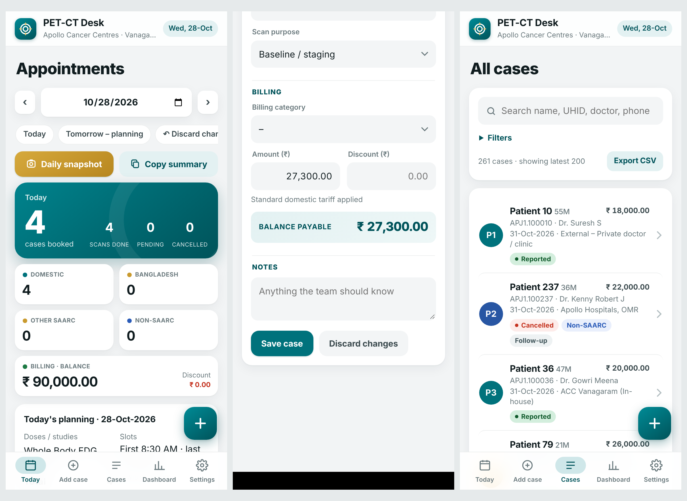

# PET-CT Team Desk

Mobile app for the PET-CT team at **Apollo Cancer Centres, Vanagaram**. It covers appointments and status, domestic and Bangladesh / SAARC patients, billing, the daily WhatsApp update, printing and a statistics dashboard.

| | |
|---|---|
| **Open the app** | https://hemakumard.github.io/petct-team-desk/ (GitHub Pages; installs to the home screen) |
| **Master requirements & prompt** | `PROMPT.md` and `docs/REQUIREMENTS.md` (Claude Docs copy: https://claude.ai/artifact/2uCroKCSJroHN1ZKyEcqKJ) |
| **Owner** | Hemakumar D, DGM – Oncology |
| **Current version** | 13 (16-Nov-2026) – runs from GitHub, no claude.ai account needed |



## How it runs (no claude.ai needed)

| Need | How the GitHub version does it |
|---|---|
| Saving cases | On the phone or computer (IndexedDB). Works offline. |
| Team sync | **Settings → Google Drive sync → Sign in with Google.** Cases are stored in one file, `petct-team-desk-data.json`, in that Google account's Drive. Every device signed in to **the same Google account** merges with it every minute. Use one team account (for example a dedicated PET-CT Gmail) on every team phone. Sharing the file with a different account does **not** work, because the app can only see files it created itself. |
| Reading case sheets, PDFs, scans, screen photos, WhatsApp text | **Settings → AI reading.** Paste a Claude API key from console.anthropic.com. The key stays on that device. Without a key, cases can still be typed by hand. |
| Appointment sheet | **Today → Appointment sheet (Excel).** Download *PET CT APPOINTMENT 2026* from the Nuclear Medicine Vanagaram email, load it, then pick a date. The file stays on the device. |
| Printing | The Print buttons open the PDF in a print window. On the computer, choose your printer. On a phone, use Save or Share. |
| Backup | **Settings → Backup:** download all cases as a .json file, or import a backup file. |

### Install on the phone
- **iPhone:** open the link in Safari → Share → **Add to Home Screen**.
- **Android:** open it in Chrome → ⋮ → **Install app** (or **Add to Home screen**).

## What's in this repository

| Path | What it is |
|---|---|
| `index.html` | The app that GitHub Pages serves. It is **built**, so don't edit it by hand. |
| `claude/index.html` | The claude.ai version (the base source). |
| `src/standalone-shim.js` | Replaces the claude.ai features: local database, Google Drive sync, Claude API, downloads |
| `src/standalone-inner.js` | GitHub-only screens: Excel upload, print window, Settings cards, backup import |
| `src/build.py` | Builds `index.html` from `claude/index.html` + `src/`. Run `python3 src/build.py` after any change |
| `manifest.json`, `sw.js`, `icon-*.png` | Lets the app install and work offline. Bump `src/VERSION` to refresh the cache |
| `PROMPT.md` | The master prompt. Add new needs under **CHANGE REQUESTS** |
| `docs/REQUIREMENTS.md` | Screens, rules and operating notes |
| `CHANGELOG.md` | Version history and backlog |
| `tests/` | Playwright tests (test data is made up) |

> **No patient data is stored in this repository.** All screenshots and test files use invented names and UHIDs.

## Updating the app
1. Edit `claude/index.html` (shared logic) or `src/*` (GitHub-only parts).
2. `python3 src/build.py`, then run the tests.
3. Bump `src/VERSION`, update `CHANGELOG.md` and `PROMPT.md`, then commit and push. GitHub Pages updates in about a minute. Phones pick up the change the next time the app is opened.

## Running the tests
```bash
cd tests
npm install
npx playwright install chromium   # first time only
node standalone_test.js && npm test
```

## Privacy
- The code is public. Patient data never goes into the repository.
- Data stays on each device and in the team Google account's Drive file. Documents sent for AI reading go to Anthropic's API using the owner's key.
- Get Apollo IT / compliance approval before live use, and give the team Google account's password only to the PET-CT team.
